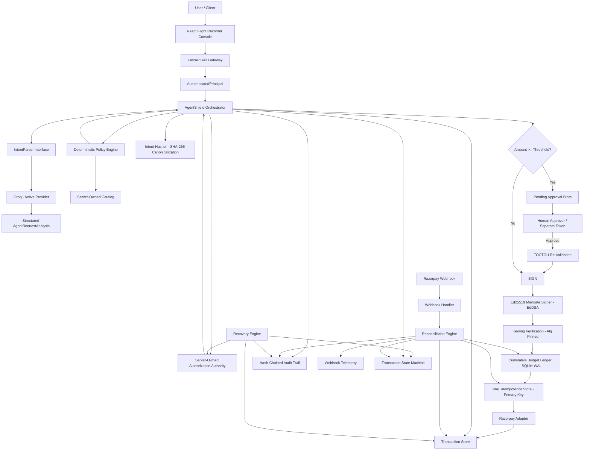
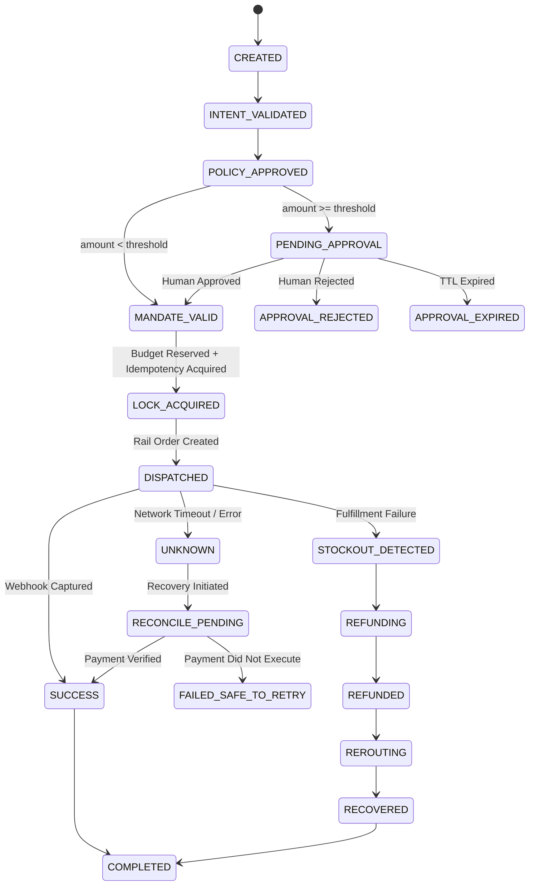

# AgentShield

[](https://github.com/s0n1c07/agentshield/actions)


> **Deterministic governance and control plane for AI-initiated financial actions**

AgentShield is a security-first transaction orchestration system that places a deterministic control plane between an AI agent and a payment rail. An LLM may interpret a natural-language request and propose a structured transaction, but it does **not** own identity, spending authority, policy decisions, payment state, or execution rights.

The core rule is simple:

> **The model proposes. AgentShield decides.**

The reference implementation uses **Groq for intent interpretation**, **Razorpay in test mode as the payment adapter**, **SQLite/WAL for persistence and concurrency controls**, **FastAPI for the API boundary**, and **React + TypeScript + Vite for the demo control console**.

The orchestrator itself has **zero dependency on any specific LLM vendor**. It is written entirely against a provider-neutral `IntentParser` interface defined in `integrations/intent_parser.py`. Groq is simply the active implementation of that interface selected at the composition root (`ApplicationContainer`). There is no vendor-specific branch, fallback, or special-cased behavior anywhere in `application/orchestrator.py`.

AgentShield is designed as an **AP2-aligned reference implementation** for agent-initiated payment governance.

---

## Quickstart

### 5-Line Docker Compose (Recommended)

```bash
git clone https://github.com/s0n1c07/agentshield.git
cd agentshield
cp .env.example .env
docker compose up --build
```

The system will start both services:
- **FastAPI Control Plane**: `http://localhost:8000` (OpenAPI Swagger at `http://localhost:8000/docs`)
- **Flight Recorder Web Console**: `http://localhost:5173`
- Demo authorizations, catalog SKUs, and cryptographic Ed25519 keys are seeded automatically on startup.

---

### Local Development Setup

```bash
# 1. Setup virtual environment & dependencies
python -m venv .venv
source .venv/bin/activate  # On Windows: .venv\Scripts\activate
pip install -r requirements.txt

# 2. Configure environment
cp .env.example .env

# 3. Seed demo data (with fresh Ed25519 signing keypair)
python -m scripts.seed_demo_data

# 4. Start API server in demo mode
export AGENTSHIELD_DEMO_MODE=true
uvicorn api.main:create_app --factory --host 0.0.0.0 --port 8000

# 5. In a separate terminal, launch the frontend
cd frontend
npm install
npm run dev
```

---

# Architecture

## System-Level Architecture



---

## Execution Sequence

A normal execution follows this deterministic sequence:

```text
1. Authenticate caller (derive server-owned user_id & agent_id)
2. Parse natural-language request via IntentParser interface (Groq)
3. Validate structured model output schema & enforce identity binding
4. Create/load server-owned transaction record (CREATED → INTENT_VALIDATED)
5. Resolve server-owned authorization & evaluate bounds deterministically
6. Snapshot exact authorization onto transaction record
7. Evaluate deterministic policy + catalog price/merchant facts
8. Move → POLICY_APPROVED
9. Check Human Approval threshold:
   - If amount >= threshold:
       - Snapshot intent_hash
       - Move → PENDING_APPROVAL
       - Persist to ApprovalStore & write APPROVAL_REQUESTED audit event
       - Return HTTP 202 Accepted (mandate creation paused)
       - Await Human Approver with AGENTSHIELD_APPROVER_TOKEN
       - On Approve: Re-validate authorization, policy, catalog, and intent_hash
10. Canonicalize proposal & compute SHA-256 intent hash
11. Generate Asymmetric Ed25519 Mandate (signed with active kid, alg="EdDSA")
12. Verify mandate against public Keyring (enforce algorithm pinning)
13. Move → MANDATE_VALID
14. Atomic Cumulative Budget Reservation (BEGIN IMMEDIATE check on daily/monthly ledger)
15. Acquire idempotency key atomically via SQLite primary key uniqueness
16. Move → LOCK_ACQUIRED
17. Create external Razorpay order (or test mock)
18. Verify returned order amount, currency, and provider status
19. Transition budget reservation → CONSUMED
20. Move → DISPATCHED
21. Await authenticated Razorpay webhook
22. Deduplicate webhook delivery & reconcile payment outcome
23. Move → SUCCESS → COMPLETED (or UNKNOWN → RECONCILE_PENDING)
24. Append hash-chained audit record
```

---

# Core Security Invariants

AgentShield enforces 18 non-negotiable security invariants across all execution paths:

### 1. Server-Owned Identity
The execution endpoint derives identity directly from the authenticated principal (`user_id`, `agent_id`) rather than trusting identity parameters sent in the body.

### 2. LLM Identity Binding
The orchestrator checks that structured model proposals strictly bind to server-provided context. Any model-side attempt to swap `user_id`, `agent_id`, or `intent_id` results in immediate termination before authorization evaluation.

### 3. Server-Owned Authorization Authority
`SQLiteAuthorizationAuthority` manages spending caps, merchant allowlists, SKU allowlists, validity windows, and revocation. Missing authorizations evaluate as `None` (no synthetic fallback authority).

### 4. Self-Consistent Authorization Evaluation
`AuthorizationEvaluation` binds the verdict directly to the evaluated authorization snapshot. Evaluations cannot reference detached or mismatched records.

### 5. Durable Authorization Snapshotting
The exact server-owned authorization governing an execution is serialized onto the transaction as an immutable snapshot.

### 6. Deterministic Policy Engine
Policy rules verify strict constraints: INR currency boundary, min/max transaction amounts, catalog SKU existence, merchant matching, exact unit pricing, and rail availability.

### 7. Cryptographic Intent Binding
The governed proposal and authorization snapshot are canonicalized and digested via SHA-256. Any modification to items, amounts, or limits alters the hash.

### 8. Asymmetric Ed25519 Mandates (Extension 3)
Mandates are cryptographically signed using Ed25519 (EdDSA). Downstream payment rails and auditors verify authenticity using public keys without requiring access to private signing keys. The verifier enforces key identifiers (`kid`), domain separation (`agentshield-mandate-v1`), and algorithm pinning (rejecting algorithm confusion attacks).

### 9. Atomic Cumulative Spending Limits (Extension 1)
In addition to per-transaction caps, AgentShield enforces calendar-based `daily_limit_paise` and `monthly_limit_paise` windows anchored to the domestic clearing timezone (`Asia/Kolkata`). Concurrent transactions are serialized at the database layer using `BEGIN IMMEDIATE`.

### 10. Compensating Release Pattern
If an execution fails after budget reservation (e.g., idempotency failure or rail communication error), the orchestrator immediately triggers a compensating release (`RELEASED`) on the ledger. Uncertain dispatches hold the reservation (`RESERVED`) until reconciled.

### 11. Human-in-the-Loop Approvals (Extension 2)
High-value transactions at or above `approval_threshold_paise` enter `PENDING_APPROVAL`. Token separation guarantees that agent tokens cannot approve transactions. Approvals mandate an authenticated approver token (`AGENTSHIELD_APPROVER_TOKEN`).

### 12. Anti-TOCTOU Re-Validation
When a human approves a pending transaction, AgentShield re-evaluates authorization status, catalog prices, and budget availability against the current database state to prevent Time-of-Check to Time-of-Use vulnerabilities.

### 13. Idempotent Execution Authority
The idempotency store relies on SQLite database primary keys (`PRIMARY KEY(idempotency_key)`) as the concurrency authority. There are zero unsafe check-then-insert patterns.

### 14. Fail-Aware State Semantics
If a payment dispatch outcome is ambiguous due to timeout or network drop, the state moves to `UNKNOWN`. The system never blindly retries; resolution occurs solely through verified reconciliation.

### 15. Webhook Signature Verification
Razorpay webhooks are verified over the raw byte body using HMAC-SHA256 comparison before payload deserialization.

### 16. Webhook Delivery Deduplication
Webhook event delivery tracking is decoupled from transaction execution idempotency (`execution identity != delivery identity`), preventing replayed webhooks from causing state corruption.

### 17. Ownership-Isolated Multi-Tenancy
Read queries across transactions, audit logs, and authorizations are strictly filtered by the authenticated principal's identifiers.

### 18. Tamper-Evident Hash-Chained Audit Trail
Every governance decision, state transition, and webhook event is recorded in a cryptographic audit chain (`previous_event_hash` -> `event_hash`). Any historical alteration invalidates the entire chain.

---

# Four Security Governance Extensions

AgentShield has been extended with four production-grade governance subsystems:

```
┌────────────────────────────────────────────────────────────────────────┐
│                        AGENTSHIELD EXTENSIONS                          │
├─────────────────────┬────────────────────┬─────────────────────────────┤
│ Extension           │ Subsystem          │ Primary Security Guarantee  │
├─────────────────────┼────────────────────┼─────────────────────────────┤
│ **Extension 3**     │ Ed25519 Mandates   │ Asymmetric signing, key     │
│                     │                    │ rotation, algorithm pinning │
├─────────────────────┼────────────────────┼─────────────────────────────┤
│ **Extension 1**     │ Cumulative Budgets │ Daily/monthly spend caps,   │
│                     │                    │ atomic BEGIN IMMEDIATE lock │
├─────────────────────┼────────────────────┼─────────────────────────────┤
│ **Extension 2**     │ Human Approvals    │ Threshold gating, token     │
│                     │                    │ separation, TOCTOU defense  │
├─────────────────────┼────────────────────┼─────────────────────────────┤
│ **Extension 4**     │ Packaging & CI/CD  │ Dockerfile, Compose, CI,    │
│                     │                    │ automated report checks     │
└─────────────────────┴────────────────────┴─────────────────────────────┘
```

### Extension 3: Ed25519 Mandates & Asymmetric Verification
- **Cryptographic Scheme**: Replaced shared-secret HMAC-SHA256 with asymmetric Ed25519 (RFC 8032) signing.
- **Key Rotation**: Structured headers include `kid` (Key Identifier). The verifier looks up public keys in `MANDATE_VERIFYING_KEYRING_JSON`.
- **Algorithm Pinning**: Pinned strictly to `alg="EdDSA"`. Attempts to pass `"HS256"`, `"RS256"`, or `"none"` are rejected immediately.
- **Domain Separation**: All signature inputs are prefixed with `"agentshield-mandate-v1"` to prevent cross-protocol signature re-purposing.

### Extension 1: Cumulative Spending Limits
- **Ledger Design**: Implemented `SQLiteSpendLedger` with schema tracking `daily_limit_paise` and `monthly_limit_paise`.
- **Concurrency Serialization**: Uses SQLite WAL `BEGIN IMMEDIATE` to execute aggregate window queries (`SELECT SUM(amount_paise)...`) and inserts atomically.
- **Compensating Action Pattern**: If an idempotency conflict or provider failure occurs after reservation, AgentShield executes a compensating release (`RELEASED`), preventing locked budget leaks.

### Extension 2: Human-in-the-Loop Approvals
- **High-Value Threshold**: Transactions with `amount_paise >= approval_threshold_paise` enter `PENDING_APPROVAL` (HTTP 202 Accepted).
- **Mandate Deferred Generation**: Mandates are not generated while waiting for human review, ensuring the 300-second cryptographic TTL does not expire during human review.
- **Token Separation**: Endpoints `/v1/approvals`, `/v1/transactions/{id}/approve`, and `/v1/transactions/{id}/reject` require `AGENTSHIELD_APPROVER_TOKEN`. Agent bearer tokens receive HTTP 403 Forbidden.
- **TOCTOU Defense**: Approval triggers fresh re-resolution of authorization, policy, catalog, and hash integrity before mandate creation.

### Extension 4: Packaging, CI/CD, & Automated Governance Checks
- **Production Dockerfile**: Multi-stage Python 3.11 build running as non-root user `agentshield`, with built-in curl healthcheck on `/healthz`.
- **Docker Compose**: Orchestrates API, React Vite frontend, SQLite storage volume, and automated database seed step.
- **Automated Verification**: `scripts/check_reports.py` validates that evaluation and adversarial benchmarks maintain exactly 0 failed cases and 0.0000 bypass rates.
- **Zero-Skip GitHub Actions CI**: Runs full pytest test suite, deterministic evaluation, red-team adversarial suite, report checks, frontend linting, and Vite production bundle build.

---

# Test & Benchmark Verification

AgentShield is backed by comprehensive test suites and security benchmarks:

| Benchmark / Test Suite | Scope & Guarantees Verified | Verified Count | Bypass Rate | Status |
|---|---|---|---|---|
| **Pytest Unit Test Suite** | State machine, Ed25519 crypto, budget concurrency, approval workflows, reconciliation, idempotency | **371 passed** (0 failed) | 0.0000 | **PASS** |
| **Deterministic Evaluation Suite** (`scripts.run_evaluation`) | Policy boundaries, catalog facts, amount caps, token injection, schema enforcement | **71/71 cases** | **0.0000** | **PASS** |
| **Adversarial Red-Team Suite** (`scripts.run_adversarial`) | Prompt injection, algorithm downgrade, key spoofing, split-purchase budget evasion, concurrent bursts | **22/22 scenarios** | **0.0000** | **PASS** |
| **Governance Report Checker** (`scripts.check_reports`) | Automated CI gate verifying evaluation and adversarial metrics | **Exit code 0** | **0.0000** | **PASS** |
| **Frontend Production Build** | TypeScript strict checks, ESLint verification, Vite production bundle | **0 errors** | N/A | **PASS** |

Run the complete verification pipeline locally:

```bash
# Run unit tests
pytest -q

# Run deterministic governance evaluation (71 cases)
python -m scripts.run_evaluation

# Run adversarial red-team benchmarks (22 scenarios)
python -m scripts.run_adversarial

# Verify report metrics
python -m scripts.check_reports
```

---

# Transaction State Machine

The transaction lifecycle is strictly enforced by `TransactionStateMachine`:



---

# Threat Model & Governance Controls

| Threat Scenario | Attack Vector | AgentShield Control |
|---|---|---|
| **Identity Impersonation** | Agent injects different `user_id` or `agent_id` | Authenticated principal derivation + output binding verification |
| **Phantom Approvals** | Model claims "transaction is pre-approved" | Server-owned authorization lookup; model claims are ignored |
| **Amount & SKU Escalation** | Agent alters price or item details | Server-owned catalog validation & exact unit price matching |
| **Currency Switching** | Agent proposes non-INR currency | Strict INR boundary enforcement at policy layer |
| **Split-Purchase Budget Evasion** | Agent splits large purchase into micro-orders | Cumulative daily & monthly spend ledger (`BEGIN IMMEDIATE`) |
| **High-Value Hijacking** | Agent executes large order without oversight | Human approval gate (`PENDING_APPROVAL`) & separate approver token |
| **Key & Algorithm Downgrade** | Attacker signs mandate with `"none"` or HMAC | Strict algorithm pinning to `"EdDSA"` & Keyring verification |
| **Replay & Duplication** | Agent or client resubmits execution | Database primary key idempotency lock (`INSERT OR IGNORE`) |
| **Stale Authorization Reuse (TOCTOU)** | User revokes authorization while waiting | Re-validation of authorization & catalog at approval & dispatch |
| **Uncertain Rail Dispatches** | Network disconnects during provider API call | Transition to `UNKNOWN` + reconciliation; zero blind retries |
| **Webhook Spoofing** | Attacker posts fake payment success webhook | Raw request body HMAC-SHA256 signature verification |
| **Audit Trail Tampering** | Attacker alters historical database records | Cryptographically linked SHA-256 hash chain (`verify_chain()`) |

---

# Design Decisions and Tradeoffs

### 1. Ed25519 Asymmetric Mandates vs HMAC-SHA256
- **Tradeoff**: HMAC is computationally faster, but symmetric. Verifying an HMAC mandate requires possessing the private signing key.
- **Decision**: In enterprise financial workflows, mandate verification must be distributed to external banking rails, clearing engines, or independent auditing services. Distributing a shared HMAC secret across multiple nodes compromises the signing authority. Ed25519 provides compact 32-byte public keys, 64-byte deterministic signatures, high resistance to side-channel attacks, and clean separation between signing authority and verification capabilities.

### 2. Database-Level Concurrency (`BEGIN IMMEDIATE`) vs Redis/Redlock
- **Tradeoff**: In-memory distributed lock systems (like Redis with Redlock) can deliver high raw throughput.
- **Decision**: Distributed locks introduce operational complexity and edge-case vulnerabilities, including clock drift, garbage collection pauses, and split-brain network partitions that can silently violate mutual exclusion. By configuring SQLite in WAL mode and using `BEGIN IMMEDIATE` transaction boundaries with filesystem-level `PRIMARY KEY` uniqueness, concurrency control is governed by the database kernel itself.

### 3. Anti-TOCTOU Re-Validation on Human Approval
- **Tradeoff**: Re-running authorization, policy, catalog, and hash integrity checks when a human clicks "Approve" adds a small CPU overhead.
- **Decision**: Time-of-Check to Time-of-Use (TOCTOU) is a severe vulnerability in human-in-the-loop systems. Hours may elapse between proposal creation and human approval. In that interval:
  1. The user may have revoked the agent's spending authorization.
  2. The merchant's catalog price or inventory may have changed.
  3. Other transactions may have depleted the daily or monthly budget.
  Treating an initial check as indefinitely valid would allow stale or revoked authority to execute financial debits.

### 4. SQLite Database Splitting & the Compensating Release Pattern
- **Tradeoff**: Splitting state across dedicated SQLite database files (`state.db.transactions`, `state.db.budget`, `state.db.idempotency`) eliminates write contention between high-throughput subsystems, but loses multi-table atomic ACID commits across distinct files without `ATTACH`.
- **Decision**: AgentShield implements an explicit **Compensating Release Pattern**. If budget reservation succeeds on the budget ledger but idempotency acquisition or payment dispatch fails, the orchestrator immediately invokes `release_reservation()`. If a crash occurs between operations, the reservation remains conservative (`RESERVED`) until reconciliation or calendar window rollover clears it, preventing double-spend risks.

---

# Known Limitations and Future Work

1. **Single-Node SQLite Scaling**:
   - While SQLite WAL mode supports high read concurrency and handles dozens of concurrent requests smoothly, write operations are serialized by a single database-level write lock. For high-scale deployments (>5,000 transactions/sec), the storage layer should be migrated to PostgreSQL with row-level locking or Google Cloud Spanner for distributed consistency.
2. **KMS & HSM Signing Enclave**:
   - In the reference implementation, Ed25519 private keys are loaded from environment variables into process memory. In high-assurance production environments, private keys should reside inside a Hardware Security Module (HSM) or cloud KMS (AWS KMS, Google Cloud KMS, HashiCorp Vault Transit), with AgentShield calling the KMS signing API.
3. **Groq JSON Fallback Retries**:
   - Upstream LLM providers may occasionally hit rate limits or return malformed JSON. The orchestrator currently fails fast on parse errors. A production enhancement would include configurable exponential backoff and schema repair prompts before marking a request invalid.
4. **Out-of-Order Webhook Delivery Queues**:
   - Webhook events are processed synchronously upon receipt. If a `payment.captured` event arrives before the initial API call completes transaction creation, the event is held. An external message broker (RabbitMQ, AWS SQS) could buffer and order webhook events during high rail latency.

---

# Project Structure

```text
agentshield/
├── .github/workflows/ci.yml         # GitHub Actions CI workflow
├── api/                             # FastAPI application boundary & routers
│   ├── dependencies.py              # Principal auth & role verification
│   └── main.py                      # REST endpoints & approval routes
├── application/                     # Orchestration & dependency injection
│   ├── container.py                 # Application composition root
│   └── orchestrator.py              # Central deterministic orchestrator
├── engine/                          # Core governance engines
│   ├── approval.py                  # Human approval SQLite store
│   ├── audit.py                     # Tamper-evident hash-chained audit trail
│   ├── authorization.py             # Server-owned authorization authority
│   ├── budget.py                    # Atomic daily/monthly budget ledger
│   ├── hashing.py                   # Canonical SHA-256 intent hasher
│   ├── idempotency.py               # Database primary-key idempotency store
│   ├── mandate.py                   # Asymmetric Ed25519 mandate engine
│   ├── policy.py                    # Deterministic policy engine
│   ├── reconciliation.py            # Webhook reconciliation & deduplication
│   └── state_machine.py             # Transaction state machine
├── evaluation/                      # Governance evaluation & adversarial benchmarks
│   ├── adversarial_scenarios.py     # 22 red-team attack scenarios
│   ├── adversarial_runner.py        # Red-team test runner
│   ├── benchmark_cases.py           # 71 deterministic evaluation test cases
│   └── benchmark_runner.py          # Benchmark test harness
├── frontend/                        # React + TypeScript + Vite console
│   ├── src/App.tsx                  # Interactive Flight Recorder & Approvals UI
│   └── Dockerfile                   # Frontend container specification
├── integrations/                    # External provider adapters
│   ├── groq_intent_parser.py        # Groq LLM IntentParser implementation
│   ├── intent_parser.py             # Provider-neutral parser interface
│   └── razorpay_adapter.py          # Razorpay test rail adapter
├── models/                          # Pydantic domain models & schemas
│   ├── approval.py                  # Approval schemas & decision payloads
│   ├── authorization.py             # Authorization models & budget caps
│   ├── mandate.py                   # Ed25519 mandate schemas (kid, alg)
│   ├── settings.py                  # Environment configuration
│   └── transaction.py               # Transaction models & state definitions
├── reports/                         # Generated benchmark artifacts
│   ├── adversarial.json             # Red-team benchmark results
│   └── evaluation.json              # Deterministic evaluation results
├── scripts/                         # Operational & benchmark scripts
│   ├── check_reports.py             # Automated report verification (CI gate)
│   ├── generate_signing_key.py      # Ed25519 keypair generation utility
│   ├── run_adversarial.py           # Adversarial benchmark runner
│   ├── run_evaluation.py            # Evaluation benchmark runner
│   └── seed_demo_data.py            # Database seeder with demo fixtures
├── tests/                           # Pytest unit & integration test suite
│   ├── test_approval.py             # Human approval & token separation tests
│   ├── test_budget.py               # Cumulative budget & concurrency tests
│   ├── test_ed25519_mandates.py     # Ed25519 signatures & key rotation tests
│   └── ...                          # Complete suite of 371 tests
├── docker-compose.yml               # Unified multi-service Compose configuration
├── Dockerfile                       # Multi-stage Python 3.11 API container
├── requirements.txt                 # Pinned Python dependencies
└── server.py                        # Standalone API server entrypoint
```

---

# License

MIT License.

Copyright (c) 2026 s0n1c07
